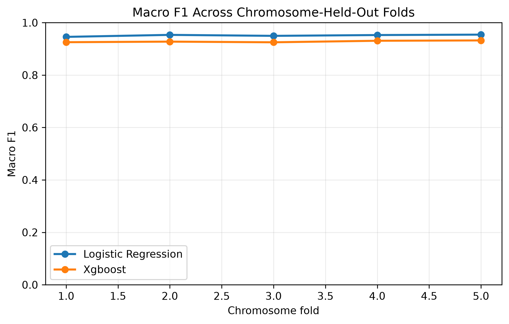

# splice-finder

`splice-finder` is a command-line bioinformatics project for predicting
splice donor and acceptor sites in genomic sequences using machine learning.
I developed this project to gain a better understanding of working with genomic
data and apply some concepts from my machine-learning and Bayesian-analysis
coursework. I also used this project to learn pipelines in python.

See [the final project report](reports/final_report.md) for methods,
evaluation, results, and limitations.

## Reference Genomes

Initial development and testing used the
[_Saccharomyces cerevisiae_ S288C reference genome](https://www.ncbi.nlm.nih.gov/datasets/genome/GCF_000146045.1/), final analysis was completed
using [_Caenorhabditis elegans_ WBcel235 reference genome](https://www.ncbi.nlm.nih.gov/datasets/genome/GCF_000002985.6/) available from NCBI.
The mitochondrial chromosome for both genomes is excluded to restrict the
analysis to strictly spliceosomal introns.

## Installation

This project uses Conda to manage its environment/dependencies.

Create the environment from `environment.yml`:

```bash
conda env create -f environment.yml
```

Then activate:

```bash
conda activate splicefind
```

## Input data

Place a reference genome and its corresponding annotation in `data/raw/`:

```text
data/
└── raw/
    ├── genome.fna
    └── annotation.gff3
```

The FASTA and GFF3 files must describe the same genome assembly, and
chromosome identifiers must match.

## Running the pipeline

Run the pipeline from the project root:

```bash
python scripts/run_pipeline.py \
  --output-dir results/species
```

The default paths are:

```text
Genome:      data/raw/genome.fna
Annotation:  data/raw/annotation.gff3
```

Custom paths and settings can be created via command-line arguments accessible
using:

```bash
python scripts/run_pipeline.py --help
```

## Pipeline output

The default output is:

```text
Output:
    results/species/
    ├── data/
    │   ├── splice_dataset.csv
    │   └── features.csv
    ├── metrics/
    │   ├── chromosome_holdout_folds.csv
    │   ├── chromosome_holdout_per_class.csv
    │   ├── chromosome_holdout_summary.csv
    │   └── run_information.json
    ├── models/
    │  └── multiclass_models.joblib
    └── figures/
        ├── macro_f1_by_fold.png
        ├── confusion_matrix_logistic_regression.png
        └── confusion_matrix_xgboost.png
```

### splice_dataset.csv

Each row represents one genomic sequence window.

| Column          | Description                                            |
| --------------- | ------------------------------------------------------ |
| `sequence`      | DNA sequence surrounding the selected genomic position |
| `label`         | Classification label: `donor`, `acceptor`, or `none`   |
| `chrom`         | Chromosome or sequence identifier                      |
| `strand`        | Genomic strand of the example                          |
| `position`      | Genomic anchor position                                |
| `intron_start`  | Start coordinate of the associated intron              |
| `intron_end`    | End coordinate of the associated intron                |
| `negative_type` | Background or hard negative donor or acceptor          |

With the default window size of 40, each sequence contains 80 nucleotides.

The script generates one donor and one acceptor example for every retained
intron. It then generates as many negative examples as there are positive
examples combined. Therefore, the `none` class is twice the size of either
individual splice-site class.

The ratio of background to hard negative examples can be changed with

```bash
 python scripts/run_pipeline.py --hard-negative-fraction 0.2
```

### Dataset validation

During dataset construction, the script reports:

- the number of genome sequences loaded;
- feature counts from the GFF3 annotation;
- the number of inferred introns;
- excluded, duplicate, malformed, and edge-clipped examples;
- the percentage of donor windows containing `GT` near the expected position;
- the percentage of acceptor windows containing `AG` near the expected
  position; and
- final class counts.

Unexpectedly low motif percentages may indicate mismatched genome and
annotation files, an incorrect transcript feature name, or a coordinate or
strand-handling problem.

The notebook checks sequence integrity, class balance, GC-content distributions,
positional nucleotide frequencies, and canonical splice-site motifs before
modeling.

### Feature and Model Selection

Each 80-nucleotide sequence is represented by 320 positional one-hot features,
GC content, and indicators for centered donor `GT` and acceptor `AG` motifs.

The final pipeline compares multiclass logistic regression and XGBoost models.
A compact Bayesian model was also explored in the modeling notebook as an
interpretable comparison, but it is not included in the final pipeline.

## Results

Models were evaluated using five chromosome-held-out folds. Logistic regression
performed slightly better than XGBoost and remained consistent across
chromosomes.

| Model               | Mean accuracy | Mean macro F1 |
| ------------------- | ------------: | ------------: |
| Logistic regression |        0.9511 |        0.9512 |
| XGBoost             |        0.9283 |        0.9283 |



See the [final report](reports/final_report.md) for class-specific results,
interpretation, and limitations.

## Reproducibility

Negative examples are generated using a configurable random seed. Running the
script with the same inputs, annotation database, settings, and seed should
produce the same sampled dataset.

The default seed is `42`. It can be changed with:

```bash
python scripts/run_pipeline.py \
  --output-dir results/species
  --seed 123
```

## Limitations

- Labels depend on the completeness and accuracy of the supplied annotation.
- Predictions use only an 80-base local sequence and do not include conservation
  or biological context.
- The constructed negative class was added for model development and does not
  represent the true genome-wide prevalence of splice sites.
- Model results will be species specific and not cross-organism
