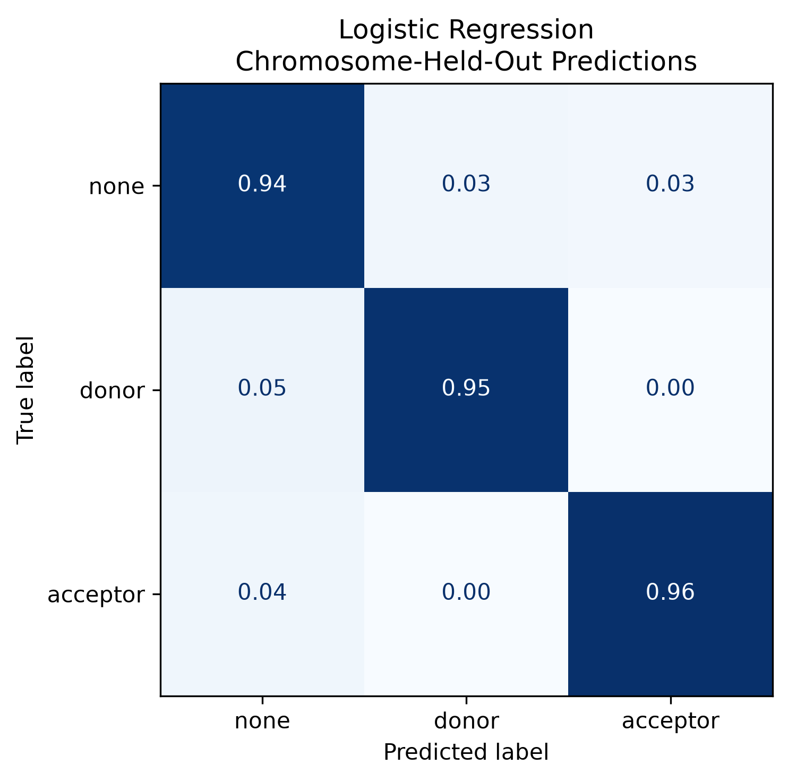

# Splice-Finder: Final Report

## Project overview

`splice-finder` is a bioinformatics project that builds labeled splice site
datasets from a reference genome and GFF3 annotation, converts DNA windows into
machine learning features, and then trains various models to distinguish splice
donors, acceptors, and non-sites. The project was meant for me to practice handling
genomic data, feature engineering, model evaluation, and pipeline design in python.

Initial development used the _Saccharomyces cerevisiae_ S288C genome. The final
pipeline evaluation used the larger _Caenorhabditis elegans_ WBcel235 genome.
Models were retrained for each organism; this evaluation therefore tests whether
the workflow scales to a larger genome, not whether a yeast-trained model transfers
directly to _C. elegans_.

## Data and methods

Introns are inferred from gaps between consecutive exons belonging to the same
annotated transcript. For each kept intron, the pipeline extracts an 80-base
window around its donor/acceptor boundaries. Minus-strand windows are reverse
complemented so every sequence is oriented in the direction of transcription.

The negative class contains an equal number of examples to the combined positive
classes. Half of the negatives are sampled from ordinary genomic background, and
half are hard negatives centered on donor-like `GT` or acceptor-like `AG` motifs
(This value can be changed to any value). This prevents the models from succeeding
only by detecting the `GT` and `AG` motifs.

Each sequence is represented by 323 predictors:

- 320 positional one-hot features representing A, C, G, or T at each of 80
  positions;
- GC content;
- a centered donor `GT` indicator; and
- a centered acceptor `AG` indicator.

The final multiclass comparison includes logistic regression and XGBoost. A
Bayesian model was also explored in the modeling notebook as an interpretable
comparison, but it used only the three summary features and was not
included as a final pipeline model.

## Evaluation

The _C. elegans_ dataset contained 447,286 rows. Evaluation used five
chromosome-held-out folds: each fold trained on some chromosomes and tested on
chromosomes not seen during training. Exact sequence overlaps were removed from
the training portion of each fold, and feature standardization was calculated
using training data only to give a more realistic estimate of genomic
generalization than a random split.

Macro F1 was treated as the primary metric because it gives equal importance to
the `none`, `donor`, and `acceptor` classes.

## Results

| Model               |   Mean accuracy |   Mean macro F1 | Macro F1 range |
| ------------------- | --------------: | --------------: | -------------: |
| Logistic regression | 0.9511 ± 0.0037 | 0.9512 ± 0.0035 |  0.9458–0.9543 |
| XGBoost             | 0.9283 ± 0.0030 | 0.9283 ± 0.0032 |  0.9251–0.9322 |

Logistic regression outperformed XGBoost in all five chromosome folds and showed
little variation between folds. Its class-level F1 scores were 0.9510 for
non-sites, 0.9464 for donors, and 0.9566 for acceptors. XGBoost achieved respective
F1 scores of 0.9282, 0.9261, and 0.9316.

The confusion matrices show that donor and acceptor sites were rarely confused
with one another. Most remaining errors involved confusing a splice site with a
non-site, which is expected because the hard-negative examples intentionally
contain splice-like motifs.

## Limitations

- Labels depend on the completeness and accuracy of the supplied annotation.
- Predictions use only an 80-base local sequence and do not include conservation
  or biological context.
- The constructed negative class was added for model development and does not
  represent the true genome-wide prevalence of splice sites.
- Model results will be species specific and not cross-organism

## Conclusion

The project produced a reproducible workflow that converts genome annotations
into model-ready data and evaluates splice-site classifiers while reducing
sequence and chromosome leakage. The strong and stable held-out results show that
the engineered sequence features capture useful splice-site patterns in
_C. elegans_. The better performance of logistic regression also demonstrates
that a simpler model can outperform a more complex tree-based model when the
positional sequence representation is already informative.
